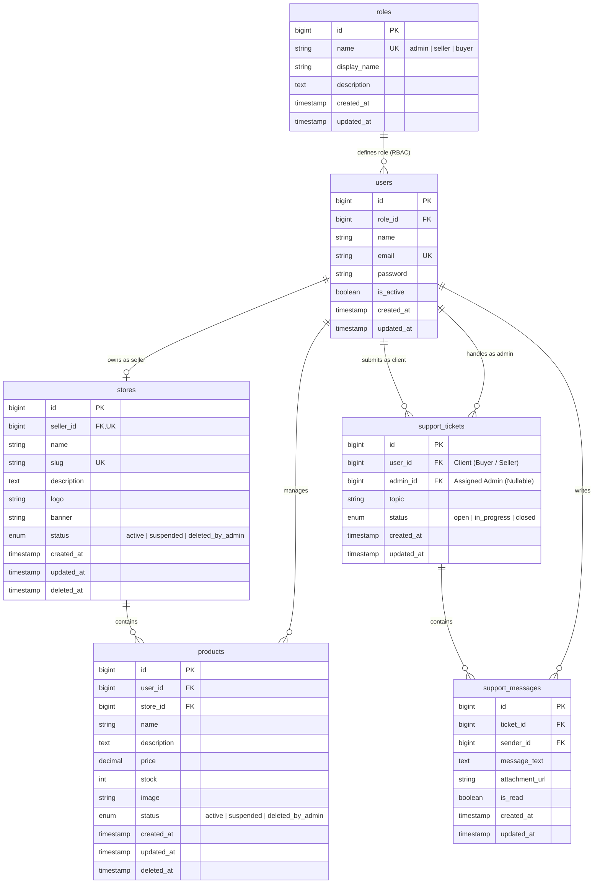

# Skema Database Relasional & Diagram ERD (gian games Marketplace)

Dokumen ini mendokumentasikan skema database relasional lengkap, optimasi indeks, aturan RBAC, serta diagram Entity-Relationship (Mermaid ERD) yang telah diimplementasikan langsung ke dalam migration dan model proyek ini.

---

## 1. Diagram Relasi Entitas (Mermaid ERD)



---

## 2. Struktur Tabel, Relasi & Indeks

### A. Tabel `roles`
* Menyimpan hak akses (`admin`, `seller`, `buyer`).
* **Indeks:** `name` (UNIQUE).

### B. Tabel `users`
* Menyimpan kredensial dan relasi peran.
* **Foreign Key:** `role_id` ➔ `roles(id)`.
* **Indeks:** `email` (UNIQUE), `idx_users_role` (`role_id`).

### C. Tabel `stores`
* Toko milik pengguna dengan role `seller`.
* **Foreign Key:** `seller_id` ➔ `users(id)` (ON DELETE RESTRICT).
* **Soft Delete:** Kolom `deleted_at` untuk moderasi toko tanpa menghapus histori pesanan.
* **Indeks:** `seller_id` (UNIQUE), `status` (Untuk filter toko aktif/terblokir).

### D. Tabel `products`
* Inventaris barang/game digital.
* **Foreign Keys:** 
  * `store_id` ➔ `stores(id)` (ON DELETE CASCADE)
  * `user_id` ➔ `users(id)`
* **Soft Delete:** Kolom `deleted_at`.
* **Indeks:** `store_id`, `status`.

### E. Tabel `support_tickets`
* Sesi tiket/percakapan bantuan terpusat.
* **Foreign Keys:**
  * `user_id` ➔ `users(id)` (Pelapor)
  * `admin_id` ➔ `users(id)` (Admin yang menangani, `NULL` jika tiket baru)
* **Indeks:** `user_id`, `admin_id`, `status`.

### F. Tabel `support_messages`
* Pesan-pesan di dalam tiket.
* **Foreign Keys:**
  * `ticket_id` ➔ `support_tickets(id)` (ON DELETE CASCADE)
  * `sender_id` ➔ `users(id)`
* **Indeks Komposit & Optimasi:**
  * `idx_support_messages_ticket` (`ticket_id`, `created_at`): Mempercepat pengambilan riwayat pesan terurut.
  * `idx_support_messages_unread` (`ticket_id`, `is_read`): Mempercepat perhitungan pesan yang belum dibaca admin/klien.

---

## 3. Daftar Model Eloquent & Relasi (PHP)

| Model | File | Relasi Utama |
|---|---|---|
| `Role` | `app/Models/Role.php` | `users()` |
| `User` | `app/Models/User.php` | `role()`, `store()`, `products()`, `reportedTickets()`, `handledTickets()`, `supportMessages()`, `isAdmin()`, `isSeller()`, `isBuyer()` |
| `Store` | `app/Models/Store.php` | `seller()`, `products()`, `isActive()` *(SoftDeletes)* |
| `Product` | `app/Models/Product.php` | `store()`, `user()`, `isActive()` *(SoftDeletes)* |
| `SupportTicket` | `app/Models/SupportTicket.php` | `user()`, `admin()`, `messages()`, `scopeActive()` |
| `SupportMessage` | `app/Models/SupportMessage.php` | `ticket()`, `sender()` |

---

## 4. Contoh Query Penting

### A. Admin Memblokir/Menghapus Toko beserta Seluruh Produknya

**Via Eloquent / DB Transaction:**
```php
use Illuminate\Support\Facades\DB;
use App\Models\Store;
use App\Models\Product;

DB::transaction(function () use ($storeId) {
    // 1. Suspend Toko dan Soft Delete
    $store = Store::findOrFail($storeId);
    $store->update(['status' => 'deleted_by_admin']);
    $store->delete(); // Mengisi kolom deleted_at

    // 2. Cascade Suspend & Soft Delete Semua Produk Toko Tersebut
    Product::where('store_id', $storeId)->update(['status' => 'deleted_by_admin']);
    Product::where('store_id', $storeId)->delete();
});
```

**Via Raw SQL:**
```sql
BEGIN TRANSACTION;

UPDATE stores 
SET status = 'deleted_by_admin', deleted_at = CURRENT_TIMESTAMP, updated_at = CURRENT_TIMESTAMP 
WHERE id = 1;

UPDATE products 
SET status = 'deleted_by_admin', deleted_at = CURRENT_TIMESTAMP, updated_at = CURRENT_TIMESTAMP 
WHERE store_id = 1;

COMMIT;
```

---

### B. Membuat Tiket Support Baru saat Klik Tombol "Support"

```php
use App\Models\SupportTicket;

// 1. Buat Tiket
$ticket = SupportTicket::create([
    'user_id' => auth()->id(),
    'topic'   => 'Kendala Top Up Diamond MLBB',
    'status'  => 'open',
]);

// 2. Buat Pesan Pembuka
$ticket->messages()->create([
    'sender_id'    => auth()->id(),
    'message_text' => 'Halo Admin, pembayaran saya sudah berhasil tapi diamond belum masuk.',
]);
```

---

### C. Admin Mengambil Daftar Chat Aktif & Jumlah Pesan Belum Dibaca

```php
use App\Models\SupportTicket;

$activeTickets = SupportTicket::active()
    ->with(['user', 'admin'])
    ->withCount(['messages as unread_messages_count' => function ($query) {
        $query->where('is_read', false)
              ->where('sender_id', '!=', auth()->id());
    }])
    ->latest('updated_at')
    ->get();
```
